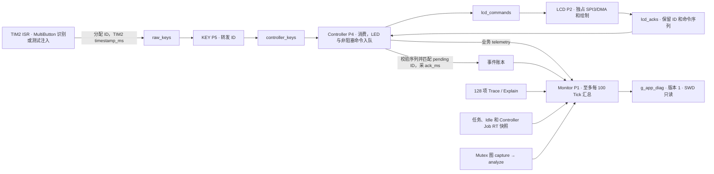

# Stage 9.4-A 综合诊断协议

## 实际事件链

Idle 由调度器保留。四业务任务、优先级、五静态队列和 LED/LCD 路径沿用原工程。生产 O2 集成配置为 DISPLAY_RTOS_O2_Integrated。DISPLAY_RTOS_O2_Integrated_Stress 仅增加现有 TIM2 测试注入开关，限 10 Hz × 600 和一批 34 次突发尝试。过去的 Trace、Timing、MSP 配置保持各自导出。正式集成配置不包含压力 mailbox。

## 发布一致性及时间域

Monitor 是唯一写者，最多每 100 Tick 开始一次采集。奇数 seq_begin 表示写入中。DMB 后采集各模块并写 seq_end；DMB 后发布相同的偶数 seq_begin。主机从 ELF DWARF 获得实际偏移，只有前读、帧内两端和后读全部相同且非零偶数时才采信。版本和 bytes 字段必须符合已读 ELF。这个协议保护整个发布帧的完整性，各子模块仍来自各自时刻，跨字段的排序和时间差只在明确规定的域内使用。

| 字段 | 来源和有效性 |
|---|---|
| events / events_ms | 原 App_Events_GetSnapshot 在现有临界区复制事件环和账本；TIM2 ms 邻近标记。 |
| queues_ms / queue_depths | 依次查询 raw key、controller key、LCD 命令、LCD ACK、Monitor metric 的深度。它们是逐个采样值。 |
| ack | 仅对与 confirmed_id 和 completed_ms 一致、仍保留在事件环的真实 ACK 给出延迟。域为 TIM2 ms，允许无符号单次回绕，超过半范围判无效。失败 ACK 可配对并保留 error；历史已淘汰、未配对、或时间不一致时 valid=0。 |
| trace | 同次最多拷贝最近 8 项和窗口元数据。窗口是 [oldest_sequence,next_sequence)，容量 128，记录覆盖累计计数。窗口内找到真实 CONTEXT_SWITCH 才发布解释；参考代数可能 stale，可从 primary_stale 和 related_stale 判断。 |
| RT | rt_begin_tick 到 rt_end_tick 间依次读取 DWT capability、四用户代、Idle 和 Job。rt_read_mask 表示对应调用成功，flags 表示时间测量有效性。READY 延迟和驻留周期来自内核，驻留可能含异常开销。 |
| DL | Monitor 的固定 384 B workspace 先 capture 再 analyze。其 capture_tick 属于内核 Tick，报告只适用于该捕获时刻；有效图中无环时标为 NO_DEADLOCK_OBSERVED。Queue 等待不形成 Mutex 边。 |
| job / attempt | Controller 最后一次命令入队尝试与 Job 快照用单独序号配对。关联不稳定或 API 失败时 job_pair_valid=0。内核快照的累计计数仍保留自己的有效性。 |

## Controller Job 范围

一次 Job 从 Controller 准备对一个非零按键 ID 调用 send_command 开始，在本次非阻塞入队尝试返回后立即完成。每次重试独立计量，attempt.command_sent 区分是否已提交；不会把 retry 计为新的输入事件。自动刷新 ID=0 不计入，也不将 Job 保留到 LCD 执行或 ACK。该范围避免并发待确认命令之间产生重叠 Job 或改变背压。预算为 72,000 DWT 驻留周期（72 MHz 下 1 ms），相对 Deadline 为 1 Tick。超限用于诊断，不参与队列流程。实测 ACK 延迟另用 TIM2 时间戳。Job 配置、释放或完成失败只反馈到诊断字段，业务入队维持原返回逻辑。

导出对象 936 B，图工作区 384 B，Controller 尝试字段单独静态存储。生产 O2 以 ARM .su 留存 Monitor 与导出函数帧，任务栈仍为每项 4 KiB，TCB 72 B，heap 0。没有新增内核机制和用户任务。

## 离线读取

从审计日志的 Integrated-diag.json 和 IntegratedProd-diag.json 运行 tests/hardware/summarize_integrated.py，可得到事件、Trace 窗口、RT/Job 与 DL 的简明 JSON。逐次健康与原帧保留在对应 JSONL。生产和压力镜像由各自的 Debug 符号版本解码，主机不硬编码结构布局。

## 一份实际帧

压力流结束的真实帧中，事件与 ACK ID 为 600。TIM2 timestamp_ms=123237，ack_ms=123310，差 73 ms，error=0。最近 Trace 窗口为 [117155,117283)，128 条在环，已累计覆盖 117155 条；所选序列 117282 是 LCD（slot 2，P2）到 Monitor（slot 3，P1）的 block_or_wake 类切换，两端 generation 均为 1，stale 均为 0。覆盖计数与入口丢弃互相独立。

同帧任务 RT 查询成功位图为 31，DWT 72 MHz，flags=1。以下是自启动的累计和 READY 峰值快照，Idle 的 READY 指标未定义，报告保留原字段。

| 任务 / slot | dispatch | DWT 驻留 cycles | 最大 READY 延迟 cycles |
|---|---:|---:|---:|
| KEY / 0 | 601 | 2,442,509 | 30,204 |
| Controller / 1 | 12,901 | 56,589,135 | 24,997 |
| LCD / 2 | 5,399 | 2,874,151,581 | 20,581 |
| Monitor / 3 | 130 | 2,127,532 | 1,073,741 |
| Idle / 8 | 9,826 | 6,352,950,173 | 不适用 |

Controller 最后一笔入队尝试记录 event_id=600、job_id=600、command_sent=1，最后及最大驻留 2,609 cycles，累计完成 600。此对照中的相同数字来自本次事件流和 Job 次数，格式没有要求两个 ID 相等。DL capture_tick=12900，4 节点、0 边，捕获与分析都成功。Monitor 的统计值从不同时间域读取。

突发最后 34 个输入中，ID 634 由 Queue FULL 拒绝，ID 633 成为最后可配对 ACK。26 笔未 ACK 历史在 8 槽被覆盖，后续由 pending ID 正确结算；无可靠的逐笔起始时间可以补算。以上示例可用离线脚本从 [原始快照](logs/Integrated-diag.json) 生成 [摘要](logs/Integrated-summary.json)。
