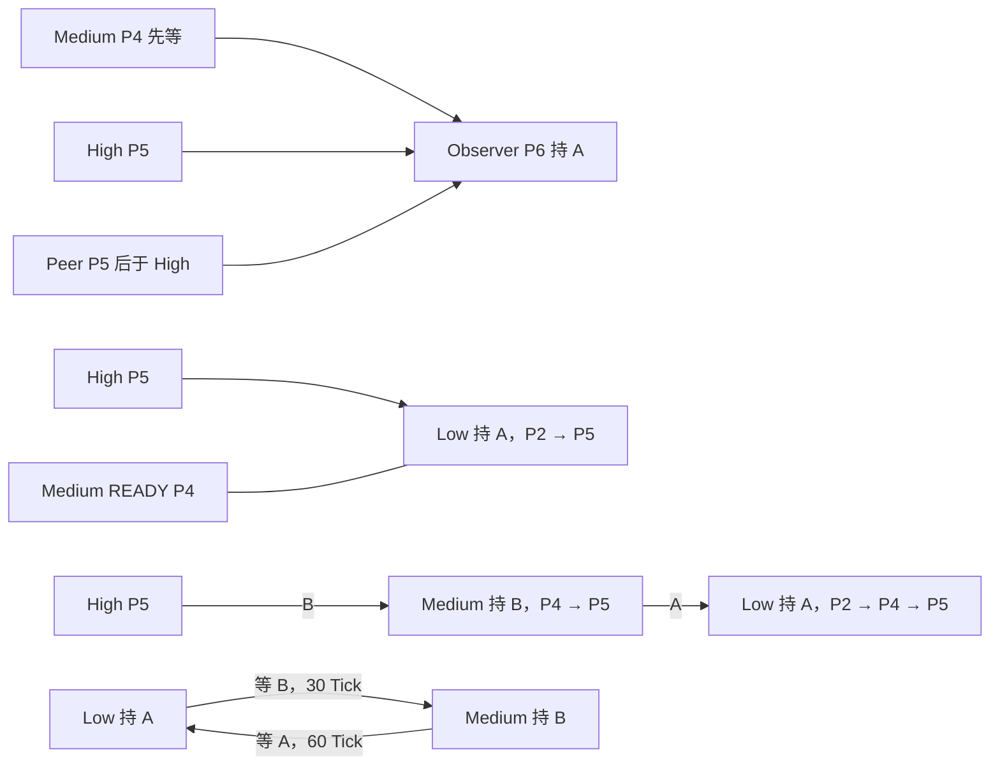

# Stage 9.4-B 测试设计与证据口径

独立 DISPLAY_RTOS_O2_Mutex / DISPLAY_RTOS_Debug_Mutex 档位在复用时钟和 TIM2 的 main 中进入测试入口。沿用现有链接器保留的 8×4 KiB 用户栈和 4 KiB MSP，链接时排除正式任务源的第二套静态栈。正式生产 O2 不链接入口和测试状态，现场最终恢复 Issue #21 已验收的原始文件。Coresight 脚本在冻结前后读状态，并两遍比较已封存的 6,896 B 报告才解码；不在运行窗口暂停 MCU。

优先级按实际内核比较（effective_priority 数值更大优先）配置。任务 refs 为 Low=(0,1)/P2、Medium=(1,1)/P4、High=(2,1)/P5、Peer=(3,1)/P5、Observer=(4,1)/P6。本轮不沿用 Issue 描述中的相反方向。四 worker 使用信号量门闩接收测试操作，Observer 用有界的 Tick 让出，并在 Thread 调用 DL。Worker 等待下一条命令的信号量没有 Mutex 所有权环关系；所有本轮 Mutex 竞争等待均带有限 Tick。

## 执行顺序与直接证明

- **交接。** Observer 在持 A 时核对返回码与真实锁所有权，再让 Medium、High、Peer 分别进入有限等待。线程快照为三个有向边指向 Observer，唯一资源。Observer 解锁后仍可继续运行，随后读取 Mutex owner 为 High 的 TCB ID 3，同时 High 的任务状态仍 READY。此时 High 尚未运行，说明所有权已直接交接。让步后实际 checkpoint 和 Trace 均为 High、Peer、Medium。最后一轮图取于 Tick 796，三个 wake tick 分别为 Medium 893、High 894、Peer 895，均未超时。该先后关系也证明同优先级以先入者优先。
- **经典 PI。** Low 先持 A，High 进入有限等待。捕获 Low base/effective 为 2/5 和 PI 标志后，Observer 先让 Medium READY，再让 Low READY。两份真实任务快照证实优先级 4 和 5。最后一轮 Trace slot 序列为 0, 2, 1, 0, Idle, 4，第一次运行的 Low 在 Medium 之前，High 的 Mutex owner 数据为 ID 3。所有轮次验证解除后恢复 base。
- **传递性 PI。** Low 持 A，Medium 持 B 再等待 A，此时 Low 的有效优先级是 4。High 再等待 B，实际两条边为 2→1、1→0，两层 owner 都提升至 5 且 PI 标志置位。释放后实际获锁顺序为 Medium 再 High，两个任务的等待资源在不同 resource ID 上。Low、Medium 的有效优先级最终回到 2、4。
- **有限 ABBA。** Observer 在 Tick 809 读取原始图，Low slot 0 等 Medium slot 1 持有的 B，Medium slot 1 等 Low slot 0 持有的 A，双方 generation 均为 1。资源 ID 为 1（B）、2（A）；两边都处于 BLOCKED 并携带 FINITE。头部无异常、缺失或溢出，捕获和分析都完成。结果 flags=3（DEADLOCK|HAS_TIMEOUT），环节点 0、1，finite_edge_count=2，earliest_due_tick=837，与实际等待队列里的 wake_tick 相同。Low 于 837 返回 RTOS_ERR_TIMEOUT（7），释放 A；Medium 同 Tick 返回 RTOS_OK、已获 A 的 owner ID 2，然后释放 A/B，自己的 Tick 868 期限未用到。两把锁的 owner、wait_head、owner_next 均回到空。Worker 此后在命令门闩等待，证明恢复后继续执行到了正确收尾点。

重复轮次在板上逐轮断言实际 owner、顺序、Trace 和最终状态。原始结构保存每类最后一轮的 workspace、任务快照、局部 Trace/Explain、checkpoint 和状态码，并另存通过轮数。局部 Trace 捕捉相关切换，128 项环没有保存 202 轮完整历史。轮数、顺序和故障由主机重新检查，历史硬件不足不会由 Host 或静态信息代替。

## 构建与部署

参考 README、Mutex/PI 接口、Wait-For 图设计和 Stage 9.2-H1 的空图证据。本轮没有发现内核缺陷。原预构建内核 CTest 使用 `ctest --test-dir build-host-stage9_2 --output-on-failure -j6` 复跑；应用和 RT 从本次 checkout 用 scripts/test/run_host.sh 和 run_rt_host.sh 构建运行。三组返回码均为 0。

独立 O2 35,132 B、Debug 49,680 B，含 MSP 的静态 SRAM 均为 50,336 B。TCB 72 B、heap=0。ARM 链接初试因同时保留正式与测试两套 .user_stacks 被原断言拦截，随后在测试档位移除正式任务源，未动链接器/内核或生产配置。按 ELF/BIN/HEX、加载段、向量和 SHA 校验。脚本的 Mutex 模式使用 build/Stage94A_Frozen_Production 指向上轮冻结的 ELF/BIN/HEX/MAP。生产恢复文件为 53,676 B，整段 Flash 读回与测试前相同。

未验收无超时永久环、ISR Mutex API、Debug 实机、外部 IRQ 时延或 WCET。本轮停止在 Stage 9.4-B。
